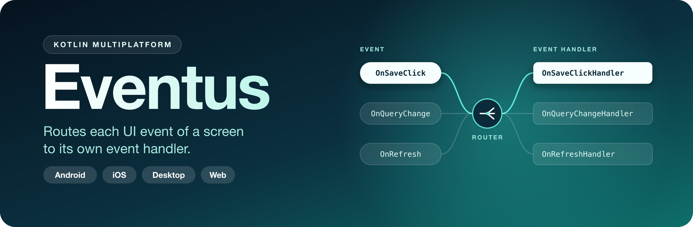

[](https://central.sonatype.com/artifact/io.github.mradzinski/eventus)
[](https://github.com/mradzinski/eventus/actions/workflows/build.yml)
[](https://codecov.io/gh/mradzinski/eventus)

# Eventus

An event router for Model-View-ViewModel (MVVM) screens on Kotlin Multiplatform. The user interface
(UI) sends events, each event goes to its own small event handler class, and the screen's state and
one-time effects come back as flows. It runs on **Android, iOS, Desktop and Web** from common code.

| | Feature | What you get |
|---|---|---|
| 🧩 | **One event, one handler** | Each event has its own small class and its own test. |
| 🚦 | **Dispatch strategies** | Run at once, latest only, in order, or ignore a repeat. |
| 🗂️ | **Across events and per item** | A strategy can cover several events, or each item of a list. |
| 🪶 | **No base class** | Your view model delegates to a router. |
| 🎯 | **One state, one-time effects** | State is one immutable value. Each effect arrives once. |
| 💉 | **Nothing to wire wrong** | Handlers get the state from the router. |
| 🛟 | **Failures in one place** | A handler that fails does not stop the screen. |
| ⚡ | **Optimistic updates** | Show the result at once. Put it back if the work fails. |
| 🔍 | **A log in one line** | See what ran, what was ignored and what was replaced. |
| 🔄 | **Survives a rotation** | Lives as long as your view model. Effects wait for the screen. |
| 📦 | **Two small dependencies** | `kotlinx.coroutines` and `atomicfu`. No Compose, no lifecycle. |
| 🧵 | **Thread-safe** | Send events from any thread. |
| 🧰 | **Optional extras** | A build-time check, generated Koin or Metro wiring, Compose helpers. |

## Contents

- [Before you begin](#before-you-begin)
- [Installing](#installing)
  - [Recommended: adding the build-time check](#recommended-adding-the-build-time-check)
  - [Optional: integration with Koin](#optional-integration-with-koin)
  - [Optional: integration with Metro](#optional-integration-with-metro)
  - [Optional: adding the Compose helpers](#optional-adding-the-compose-helpers)
- [Quick start](#quick-start)
- [Documentation](#documentation)
- [Changelog](#changelog)
- [License](#license)

## Before you begin

- **Kotlin 2.4.21 or newer.** The library is built with that version and does not support older
  compilers.
- **`kotlinx-coroutines` 1.11.0 or newer**, which the library brings in by itself.
- Targets: `android` (minSdk 24), `jvm`, `iosArm64`, `iosSimulatorArm64`, `iosX64`, `js`, `wasmJs`.
- The examples use the multiplatform `androidx.lifecycle` `ViewModel` and Compose, because that is
  how most apps use the library. Neither is required.
- **Working with an AI agent?** Give it [AGENT-USAGE.md](AGENT-USAGE.md). It is one file with
  everything an agent needs to write correct Eventus code: the API, the rules, a complete screen,
  the error messages with their fixes, and skills it can save.

## Installing

```kotlin
// build.gradle.kts of the module that holds your screens
kotlin {
    sourceSets {
        commonMain.dependencies {
            implementation("io.github.mradzinski:eventus:1.0.0-rc02")
        }
    }
}
```

The library needs nothing else. The steps below are optional, and the first one is recommended.

### Recommended: adding the build-time check

`eventus-ksp` is a [Kotlin Symbol Processing (KSP)](https://kotlinlang.org/docs/ksp-overview.html)
processor. With it, an event that has no handler fails the build; without it, that event throws at
runtime if sent. It runs while your app is built and is never part of the app.

Add the KSP plugin, 2.3.12 or newer, and the processor once for every target of the module:

```kotlin
// build.gradle.kts of the module that holds your screens
plugins {
    id("com.google.devtools.ksp") version "2.3.14"
}

dependencies {
    add("kspAndroid", "io.github.mradzinski:eventus-ksp:1.0.0-rc02")
    add("kspJvm", "io.github.mradzinski:eventus-ksp:1.0.0-rc02")
    add("kspIosArm64", "io.github.mradzinski:eventus-ksp:1.0.0-rc02")
    add("kspIosSimulatorArm64", "io.github.mradzinski:eventus-ksp:1.0.0-rc02")
}
```

A configuration is named after its target: `ksp` and the target's name with a capital first letter. In
a module with a single platform, the one line is `ksp("io.github.mradzinski:eventus-ksp:1.0.0-rc02")`.

### Optional: integration with Koin

If you use Koin, `eventus-koin` lets the processor write the Koin module of your event handlers from
one annotated property. It needs the build-time check above. See [Generating the Koin
module](docs/checking-and-wiring-event-handlers-at-build-time.md#generating-the-koin-module).

```kotlin
commonMain.dependencies {
    implementation("io.github.mradzinski:eventus-koin:1.0.0-rc02")
}
```

### Optional: integration with Metro

If you use Metro, `eventus-metro` lets the processor write the Metro bindings of your event handlers
from one annotation on each screen. It needs the build-time check above. See [Generating the Metro
bindings](docs/checking-and-wiring-event-handlers-at-build-time.md#generating-the-metro-bindings).

```kotlin
commonMain.dependencies {
    implementation("io.github.mradzinski:eventus-metro:1.0.0-rc02")
}
```

### Optional: adding the Compose helpers

`eventus-compose` adds two helpers for a Compose UI: one that performs a router's effects, and one that
tells the router when the screen is visible. See [Using the Compose helpers](docs/using-the-compose-helpers.md).

```kotlin
commonMain.dependencies {
    implementation("io.github.mradzinski:eventus-compose:1.0.0-rc02")
}
```

## Quick start

The example is a counter with a save button. It uses three things from your own app, which are not
shown: a `CounterRepository` that saves the count, a `FailureReason` type with a
`Throwable.toFailureReason()` function, and a `CounterScreen` composable that draws the state.

**1. Describe the screen.** Its state, the events the UI can send and the effects the UI must
perform, each as a sealed type or a data class of your own.

```kotlin
import io.github.mradzinski.eventus.UiEffect
import io.github.mradzinski.eventus.UiEvent
import io.github.mradzinski.eventus.UiState

sealed interface CounterEvent : UiEvent {

    data object OnIncrementClick : CounterEvent
    data object OnSaveClick : CounterEvent
}

data class CounterUiState(val count: Int = 0) : UiState

sealed interface CounterEffect : UiEffect {

    data object Saved : CounterEffect
    data class ShowFailure(val reason: FailureReason) : CounterEffect
}
```

**2. Write one event handler for each event.** An event handler takes what it really depends on in
its constructor. The screen's state and effects come in with each call, as the `store`.

```kotlin
import io.github.mradzinski.eventus.DispatchStrategy
import io.github.mradzinski.eventus.EventHandler
import io.github.mradzinski.eventus.ScreenStore

typealias CounterStore = ScreenStore<CounterUiState, CounterEffect>

class OnIncrementClickHandler : EventHandler<CounterEvent.OnIncrementClick, CounterUiState, CounterEffect> {

    override val eventType = CounterEvent.OnIncrementClick::class

    override suspend fun handle(event: CounterEvent.OnIncrementClick, store: CounterStore) {
        store.update { it.copy(count = it.count + 1) }
    }
}

class OnSaveClickHandler(
    private val counters: CounterRepository,
) : EventHandler<CounterEvent.OnSaveClick, CounterUiState, CounterEffect> {

    override val eventType = CounterEvent.OnSaveClick::class

    // A second tap on Save is ignored while a save is running.
    override val strategy = DispatchStrategy.DropIfAlreadyRunning<CounterEvent.OnSaveClick>()

    override suspend fun handle(event: CounterEvent.OnSaveClick, store: CounterStore) {
        counters.save(store.current.count)   // throws when it fails: the screen's ErrorHandler takes it
        store.emit(CounterEffect.Saved)
    }
}
```

Every event needs exactly one handler. With [`eventus-ksp`](#recommended-adding-the-build-time-check) the
build tells you when one is missing: add an event to `CounterEvent` and forget its handler, and the
module no longer compiles.

**3. Give the router to the UI through your view model.** The view model has no logic. It delegates
`state`, `effects` and `onEvent` to the router.

```kotlin
import androidx.lifecycle.ViewModel
import io.github.mradzinski.eventus.EventHandler
import io.github.mradzinski.eventus.EventRouter
import io.github.mradzinski.eventus.routerScope
import kotlinx.coroutines.CoroutineScope

class CounterViewModel(
    handlers: Collection<EventHandler<*, CounterUiState, CounterEffect>>,
    scope: CoroutineScope = routerScope(),
) : ViewModel(scope),
    EventRouter<CounterEvent, CounterUiState, CounterEffect> by EventRouter(
        scope = scope,
        initialState = CounterUiState(),
        handlers = handlers,
        errorHandler = { _, error, store -> store.emit(CounterEffect.ShowFailure(error.toFailureReason())) },
    )
```

**4. Use the view model from the UI.** Draw the state, send events, perform effects.

```kotlin
import androidx.compose.runtime.Composable
import androidx.compose.runtime.LaunchedEffect
import androidx.compose.runtime.getValue
import androidx.lifecycle.compose.collectAsStateWithLifecycle

@Composable
fun CounterRoute(viewModel: CounterViewModel) {
    val state by viewModel.state.collectAsStateWithLifecycle()

    LaunchedEffect(viewModel) {
        viewModel.effects.collect { effect ->
            when (effect) {
                is CounterEffect.Saved -> { /* show a confirmation */ }
                is CounterEffect.ShowFailure -> { /* show why */ }
            }
        }
    }

    CounterScreen(
        state = state,
        onEvent = viewModel::onEvent,
    )
}
```

With [`eventus-compose`](#optional-adding-the-compose-helpers), the block that collects the effects becomes one
call, which also waits for the screen to be started before performing an effect:

```kotlin
import io.github.mradzinski.eventus.compose.collectEffects

viewModel.collectEffects { effect ->
    when (effect) {
        is CounterEffect.Saved -> { /* show a confirmation */ }
        is CounterEffect.ShowFailure -> { /* show why */ }
    }
}
```

**5. Check that it works.** Run the app and send `OnIncrementClick` from your screen, for example
from a button: the count on screen goes up by one each time. If you added
[`eventus-ksp`](#recommended-adding-the-build-time-check), delete `OnSaveClickHandler` and build
again: the build fails with `No handler for CounterEvent.OnSaveClick`, with your package before the
name.

## Documentation

Each topic has a page of its own in [`docs/`](docs). They are listed with what most apps need first.

| Guide | What it covers |
|---|---|
| [Key concepts](docs/key-concepts.md) | How an event travels through Eventus, what each piece is, the lifecycle of each, and the rules that follow. Start here. |
| [Choosing a dispatch strategy](docs/choosing-a-dispatch-strategy.md) | What the router does with an event while other events are active: the four ready-made strategies with a real case each, sharing one between several events, applying one to each item of a list, and writing your own. |
| [Dependency injection](docs/dependency-injection.md) | Wiring event handlers with Koin, with Metro, with another compile-time container, or by hand. |
| [Checking and wiring event handlers at build time](docs/checking-and-wiring-event-handlers-at-build-time.md) | The `eventus-ksp` processor: the missing-handler check, the generated Koin module, the generated Metro bindings, and projects with several modules. |
| [Using the Compose helpers](docs/using-the-compose-helpers.md) | The `eventus-compose` artifact: performing effects with the lifecycle, and notifying the router that the screen is visible. |
| [Handling failures](docs/handling-failures.md) | Where an event handler's exception goes, and how to turn it into something the UI can show. |
| [Keeping work running](docs/keeping-work-running.md) | Event handlers that never return, such as one that collects a flow, and how long they last. |
| [Testing](docs/testing.md) | Testing an event handler, a view model, and that every event has a handler. |
| [Choosing between an effect and state](docs/choosing-between-an-effect-and-state.md) | How to decide whether something is an effect or part of the state. |
| [Navigating](docs/navigating.md) | Navigating as an effect that carries only an id. |
| [Debouncing](docs/debouncing.md) | Waiting until the user has stopped typing before doing the expensive part. |
| [Updating the state optimistically](docs/updating-the-state-optimistically.md) | Showing a result at once and putting it back if the work fails. |
| [Reaching another screen](docs/reaching-another-screen.md) | How one screen affects another without an event bus. |
| [Choosing the coroutine scope](docs/choosing-the-coroutine-scope.md) | Which scope the router runs in, who cancels it, and threads. |
| [Logging events](docs/logging-events.md) | Having the router report what it does with each event: ignored, replaced, waiting, started, the effects it emitted and how it ended. One line gives a log, and a test can check the reports. |
| [Structuring the events of a feature](docs/structuring-the-events-of-a-feature.md) | One event type for a feature with several screens, with a sealed type for each screen inside it. |
| [Where Eventus sits in your app](docs/where-eventus-sits-in-your-app.md) | Which modules of an app depend on Eventus and which never do. |
| [What Eventus does not do](docs/what-eventus-does-not-do.md) | The limits of the library, stated plainly. |
| [Project layout](docs/project-layout.md) | The modules of this repository, and how to run the sample, the checks and the formatter. |
| [Class diagram](docs/class-diagram.md) | Every type of the `eventus` module, public and internal, and how the types relate, as a picture. |

## Changelog

See [CHANGELOG.md](CHANGELOG.md).

## License

Eventus is free to use, including in commercial apps, under the Apache License 2.0. The full text is
in [LICENSE](LICENSE).

**If you ship Eventus in an app, credit it.** Include the contents of [NOTICE](NOTICE), which names
the library and links to this repository, wherever your app lists its third-party software: an
"open source licenses" screen, an about page or the documentation. The license requires this of
anything that redistributes the library (section 4).

```
Copyright 2026 Matias Radzinski

Licensed under the Apache License, Version 2.0 (the "License");
you may not use this file except in compliance with the License.
You may obtain a copy of the License at

    http://www.apache.org/licenses/LICENSE-2.0

Unless required by applicable law or agreed to in writing, software
distributed under the License is distributed on an "AS IS" BASIS,
WITHOUT WARRANTIES OR CONDITIONS OF ANY KIND, either express or implied.
See the License for the specific language governing permissions and
limitations under the License.
```
