# Choosing a dispatch strategy

Events do not arrive one at a time. A user taps Save twice, types faster than a search answers, or
taps Delete while a save is still running. A dispatch strategy is how an event handler tells the
router what to do with an event while other events are still active.

An event is **active** from the moment the router accepts it until its event handler returns, fails
or is cancelled. That includes events that are waiting for their turn.

Each event handler chooses its strategy by overriding `strategy`. If it does not, it gets
`Concurrent`.

The examples on this page give each screen a handler interface and a name for its store, as
[dependency injection](dependency-injection.md) shows. `SearchHandler<E>` stands for
`EventHandler<E, SearchUiState, SearchEffect>`, and `SearchStore` for
`ScreenStore<SearchUiState, SearchEffect>`.

## Contents

- [The four ready-made strategies](#the-four-ready-made-strategies)
  - [The type in the brackets](#the-type-in-the-brackets)
  - [`Concurrent`: every event runs at once](#concurrent-every-event-runs-at-once)
  - [`Latest`: the newest event replaces the one before](#latest-the-newest-event-replaces-the-one-before)
  - [`Sequential`: events run in the order they were sent](#sequential-events-run-in-the-order-they-were-sent)
  - [`DropIfAlreadyRunning`: a repeat is ignored](#dropifalreadyrunning-a-repeat-is-ignored)
- [Sharing a strategy between several events](#sharing-a-strategy-between-several-events)
  - [The newest of several inputs: `Latest<T>()`](#the-newest-of-several-inputs-latestt)
  - [Actions that exclude each other: `DropIfAlreadyRunning<T>()`](#actions-that-exclude-each-other-dropifalreadyrunningt)
  - [Several events in order: `Sequential<T>()`](#several-events-in-order-sequentialt)
  - [Keeping the event handlers in agreement](#keeping-the-event-handlers-in-agreement)
- [Applying a strategy to each item of a list](#applying-a-strategy-to-each-item-of-a-list)
  - [Each item in order: `Sequential<T> { key }`](#each-item-in-order-sequentialt--key-)
  - [Each item once: `DropIfAlreadyRunning<T> { key }`](#each-item-once-dropifalreadyrunningt--key-)
  - [The newest for each item: `Latest<T> { key }`](#the-newest-for-each-item-latestt--key-)
  - [Several events for each item](#several-events-for-each-item)
- [Writing your own strategy](#writing-your-own-strategy)
  - [The rules of a strategy function](#the-rules-of-a-strategy-function)
- [What the router keeps](#what-the-router-keeps)

## The four ready-made strategies

| Strategy | An event arrives while an earlier one is active | A real case |
|---|---|---|
| `Concurrent` (default) | Both run at once. | Typing in a text field. |
| `Latest<T>()` | The earlier one is cancelled, and the new one runs. | A search box. |
| `Sequential<T>()` | The new one waits, and they run in the order they were sent. | The plus button of a quantity. |
| `DropIfAlreadyRunning<T>()` | The new one is ignored. | A Pay button tapped twice. |

### The type in the brackets

The type in the brackets says which events the strategy looks at. Read it as the end of the
sentence: `DropIfAlreadyRunning<OnPayClick>()` is "ignore this event if an `OnPayClick` is already
running".

| You write in the brackets | The strategy looks at | Section |
|---|---|---|
| The handler's own event | Events of that type only. Two different events never wait for, cancel or ignore each other. | The four sections that follow |
| A type that several events share | Every active event of that type. | [Sharing a strategy between several events](#sharing-a-strategy-between-several-events) |
| A type, and a key in braces | The active events of that type with the same key. | [Applying a strategy to each item of a list](#applying-a-strategy-to-each-item-of-a-list) |

A type the handler's event does not belong to does not compile. `Concurrent` has no brackets,
because it looks at nothing.

### `Concurrent`: every event runs at once

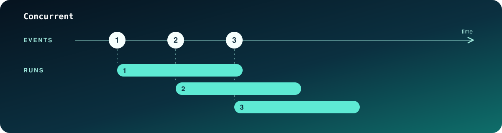

Use `Concurrent` when an event does something quick and two of them cannot get in each other's way.
Most events are like this, which is why it is the default and you write nothing.

**A real case:** the name field of a profile form. Every keystroke sends `OnNameChange`, and the
handler copies the text into the state.

```kotlin
class OnNameChangeHandler : ProfileHandler<OnNameChange> {

    override val eventType = OnNameChange::class

    override suspend fun handle(event: OnNameChange, store: ProfileStore) {
        store.update { it.copy(name = event.name) }
    }
}
```

### `Latest`: the newest event replaces the one before

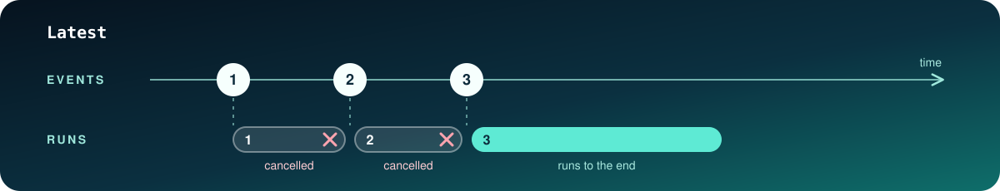

Use `Latest` when a new event makes the work of the earlier one pointless.

**A real case:** a search box that searches as the user types.

```kotlin
class OnQueryChangeHandler(private val products: ProductRepository) : SearchHandler<OnQueryChange> {

    override val eventType = OnQueryChange::class
    override val strategy = DispatchStrategy.Latest<OnQueryChange>()

    override suspend fun handle(event: OnQueryChange, store: SearchStore) {
        store.update { it.copy(query = event.query) }

        val results = products.search(event.query)

        store.update { it.copy(results = results) }
    }
}
```

| The user | The router |
|---|---|
| Types `c`. | Starts the search for `c`. |
| Types `ca` before that search answers. | Cancels the search for `c` and starts the search for `ca`. |
| Waits. | The results for `ca` reach the state. The results for `c` never do. |

Without `Latest`, both searches run, and if the one for `c` answers last, the screen shows the
results for `c` under a box that says `ca`. To also wait until the user stops typing, see
[debouncing](debouncing.md).

### `Sequential`: events run in the order they were sent

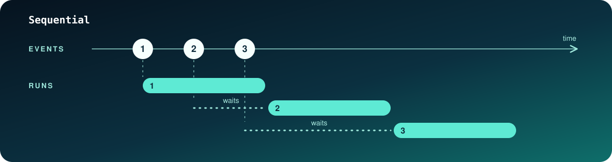

Use `Sequential` when every event must be applied, and in order.

**A real case:** the plus button of a quantity in a shopping cart. Each tap saves the new quantity,
and each save starts from what the save before it left.

```kotlin
class OnPlusClickHandler(private val cart: CartRepository) : CartHandler<OnPlusClick> {

    override val eventType = OnPlusClick::class
    override val strategy = DispatchStrategy.Sequential<OnPlusClick>()

    override suspend fun handle(event: OnPlusClick, store: CartStore) {
        val quantity = store.current.quantity + 1

        cart.setQuantity(quantity)
        store.update { it.copy(quantity = quantity) }
    }
}
```

| The user | The router |
|---|---|
| Taps plus three times, quickly. | Runs the first tap. The second and third wait. |
| Waits. | Runs the second tap when the first has ended, then the third. The quantity is 3. |

Without `Sequential`, the three taps run at once, each reads the same quantity, and the cart ends
at 1. A run that fails does not stop the ones that wait behind it.

### `DropIfAlreadyRunning`: a repeat is ignored

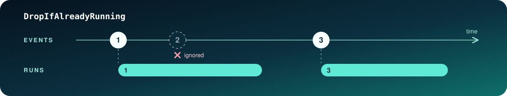

Use `DropIfAlreadyRunning` for an action that must not run twice.

**A real case:** the Pay button of a checkout.

```kotlin
class OnPayClickHandler(private val payments: PaymentRepository) : CheckoutHandler<OnPayClick> {

    override val eventType = OnPayClick::class
    override val strategy = DispatchStrategy.DropIfAlreadyRunning<OnPayClick>()

    override suspend fun handle(event: OnPayClick, store: CheckoutStore) {
        payments.pay(store.current.order)
        store.emit(CheckoutEffect.Paid)
    }
}
```

| The user | The router |
|---|---|
| Taps Pay. | Starts the payment. |
| Taps Pay again while the payment is running. | Ignores the tap. The order is paid once. |
| Taps Pay after a payment that failed. | Starts a new payment: nothing is active any more. |

## Sharing a strategy between several events

Sometimes several events are one thing to the user. Give the events a sealed type of their own, and
pass that type to the strategy. The strategy then looks at every active event of that type,
whichever event it is.

### The newest of several inputs: `Latest<T>()`

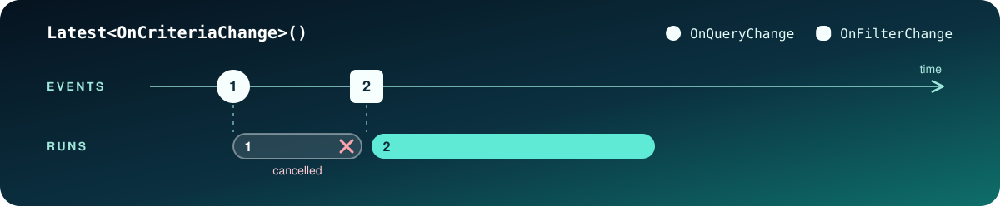

**A real case:** a product list that reloads when the user changes the search text, the filter or
the sort order. Only the newest of the three matters.

```kotlin
sealed interface SearchEvent : UiEvent {

    /** Everything that reloads the results. Only the newest one matters. */
    sealed interface OnCriteriaChange : SearchEvent

    data class OnQueryChange(val query: String) : OnCriteriaChange
    data class OnFilterChange(val filter: Filter) : OnCriteriaChange
    data class OnSortChange(val sort: Sort) : OnCriteriaChange
}

val latestCriteria = DispatchStrategy.Latest<SearchEvent.OnCriteriaChange>()
```

Each of the three handlers uses that one value:

```kotlin
class OnFilterChangeHandler(private val products: ProductRepository) : SearchHandler<OnFilterChange> {

    override val eventType = OnFilterChange::class
    override val strategy = latestCriteria

    override suspend fun handle(event: OnFilterChange, store: SearchStore) {
        store.update { it.copy(filter = event.filter) }

        val results = products.search(
            query = store.current.query,
            filter = event.filter,
            sort = store.current.sort,
        )

        store.update { it.copy(results = results) }
    }
}
```

| The user | The router |
|---|---|
| Types `cat`. | Starts the search for `cat`. |
| Picks the filter "New" before that search answers. | Cancels the search for `cat` and starts the search for `cat` with "New". |

If each handler named only its own event, as in `Latest<OnFilterChange>()`, the two searches would
run at once, because they come from two different events. If the first one answers last, the
screen would show results that ignore the filter.

### Actions that exclude each other: `DropIfAlreadyRunning<T>()`

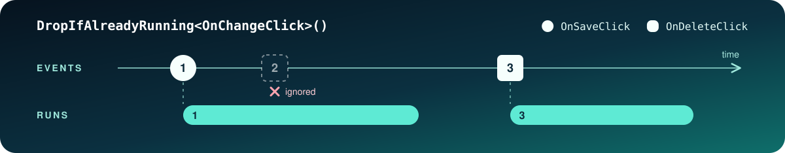

**A real case:** the Save and Delete buttons of an editor. While a save is running, Delete must do
nothing, and the other way round.

```kotlin
sealed interface EditorEvent : UiEvent {

    data class OnNameChange(val name: String) : EditorEvent

    /** The actions that change the task on the server. Only one of them runs at a time. */
    sealed interface OnChangeClick : EditorEvent

    data object OnSaveClick : OnChangeClick
    data object OnDeleteClick : OnChangeClick
}

val oneChangeAtATime = DispatchStrategy.DropIfAlreadyRunning<EditorEvent.OnChangeClick>()
```

`OnSaveClickHandler` and `OnDeleteClickHandler` both declare
`override val strategy = oneChangeAtATime`.

| The user | The router |
|---|---|
| Taps Save. | Starts the save. |
| Taps Delete while the save is running. | Ignores the tap. |
| Types in the name field. | Runs it: `OnNameChange` is not an `OnChangeClick`. |
| Taps Delete after the save has ended. | Starts the delete. |

### Several events in order: `Sequential<T>()`

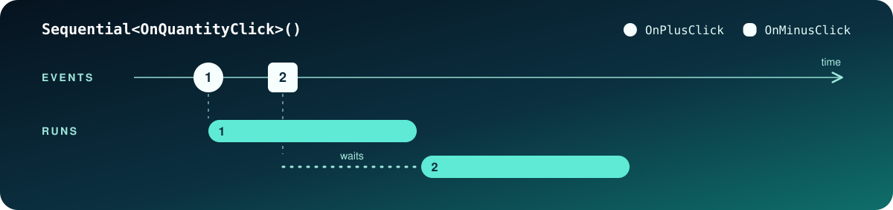

**A real case:** the plus and minus buttons of a quantity. A plus followed by a minus must end where
it started, so the two events share one order.

```kotlin
sealed interface CartEvent : UiEvent {

    /** The taps that change the quantity. They are applied in the order they were made. */
    sealed interface OnQuantityClick : CartEvent

    data object OnPlusClick : OnQuantityClick
    data object OnMinusClick : OnQuantityClick
}

val quantityInOrder = DispatchStrategy.Sequential<CartEvent.OnQuantityClick>()
```

If each handler named only its own event, the plus taps would be in order among themselves and so
would the minus taps, but a minus would not wait for a plus.

### Keeping the event handlers in agreement

- **Declare the strategy once and use that value in every handler of the type**, as in the cases
  above. Two handlers that each write their own can disagree, and nothing reports it.
- **A shared strategy fits only the events of its type.** A handler of an event that is not an
  `OnCriteriaChange` cannot use `latestCriteria`: the code does not compile.
- **Give every event of the type the shared strategy.** An event of the type whose handler keeps
  another strategy is still seen by the others, but does not follow the rule itself.

## Applying a strategy to each item of a list

On a list, one event serves every row, but the rows have nothing to do with each other. Pass the
event's type and a key, such as the id of the item. The strategy then looks only at active events
with the same key.

### Each item in order: `Sequential<T> { key }`

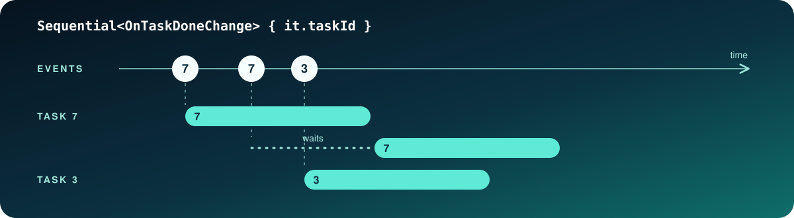

**A real case:** ticking tasks in a to-do list. Two changes to one task must reach the server in
order, and a task must not wait for another task.

```kotlin
data class OnTaskDoneChange(val taskId: Long, val done: Boolean) : TaskListEvent

class OnTaskDoneChangeHandler(private val tasks: TaskRepository) : TaskListHandler<OnTaskDoneChange> {

    override val eventType = OnTaskDoneChange::class
    override val strategy = DispatchStrategy.Sequential<OnTaskDoneChange> { it.taskId }

    override suspend fun handle(event: OnTaskDoneChange, store: TaskListStore) {
        tasks.setDone(id = event.taskId, done = event.done)
    }
}
```

| The user | The router |
|---|---|
| Ticks task 7. | Starts saving task 7 as done. |
| Unticks task 7 at once. | Waits for the first save of task 7, then saves it as not done. |
| Ticks task 3 meanwhile. | Starts saving task 3 right away. |

Without the key, `Sequential<OnTaskDoneChange>()` would make task 3 wait behind task 7. `Concurrent`
would let the two changes to task 7 run at once, and the server could end with the wrong one.

### Each item once: `DropIfAlreadyRunning<T> { key }`

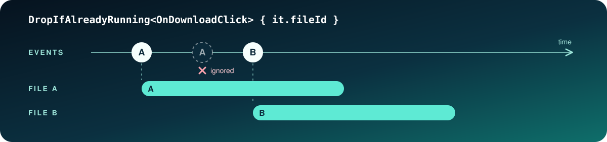

**A real case:** a Download button on every file of a list. A second tap on a file that is
downloading does nothing, and other files still download.

```kotlin
override val strategy = DispatchStrategy.DropIfAlreadyRunning<OnDownloadClick> { it.fileId }
```

### The newest for each item: `Latest<T> { key }`

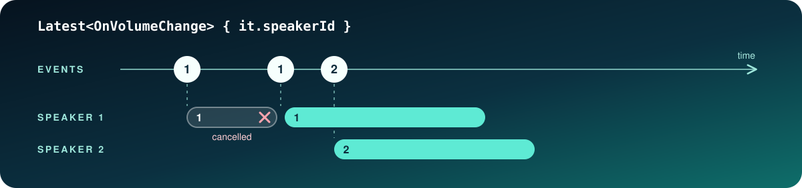

**A real case:** a volume slider on every speaker of a room. A new position cancels the save of the
position before it for that speaker, and leaves the other speakers alone.

```kotlin
override val strategy = DispatchStrategy.Latest<OnVolumeChange> { it.speakerId }
```

### Several events for each item

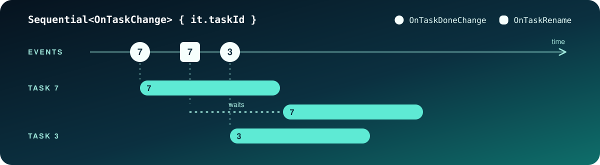

The type can be one that several events share, as long as it holds the key. Here a tick and a rename
of the same task run in order, and other tasks do not wait:

```kotlin
sealed interface OnTaskChange : TaskListEvent {

    val taskId: Long
}

data class OnTaskDoneChange(override val taskId: Long, val done: Boolean) : OnTaskChange
data class OnTaskRename(override val taskId: Long, val name: String) : OnTaskChange

val eachTaskInOrder = DispatchStrategy.Sequential<OnTaskChange> { it.taskId }
```

## Writing your own strategy

When no ready-made strategy says what you need, write the strategy as a function. It receives the
new event and the list of every active event of the screen, oldest first, and returns what to do:

| Answer | What the router does |
|---|---|
| `Dispatch.Run` | Runs the event now. |
| `Dispatch.Ignore` | Does not run the event. |
| `Dispatch.Replace(events)` | Cancels those events, then runs the new one. |
| `Dispatch.WaitFor(events)` | Runs the event when those events have ended. |

**A real case:** a list that loads more rows as the user scrolls, with a Refresh button. A refresh
replaces a "load more" that is running, because its rows are about to be thrown away. A "load more"
during a refresh is ignored, and so is a second refresh.

```kotlin
class OnRefreshHandler(private val feed: FeedRepository) : FeedHandler<OnRefresh> {

    override val eventType = OnRefresh::class

    override val strategy = DispatchStrategy<OnRefresh> { _, active ->
        if (active.any { it is OnRefresh }) {
            Dispatch.Ignore
        } else {
            Dispatch.Replace(active.filterIsInstance<OnLoadMore>())
        }
    }

    override suspend fun handle(event: OnRefresh, store: FeedStore) {
        val posts = feed.firstPage()

        store.update { it.copy(posts = posts) }
    }
}
```

"Load more" needs no function. With a type that both events share, it is a ready-made strategy:

```kotlin
// In OnLoadMoreHandler. OnRefresh and OnLoadMore are both an OnFeedLoad.
override val strategy = DispatchStrategy.DropIfAlreadyRunning<OnFeedLoad>()
```

### The rules of a strategy function

- **Only compute the answer.** The router calls the function when the event is sent, on the thread
  that sent it, and calls it again if the active events changed in the meantime. Work that takes
  time belongs in `handle`.
- **Name the events you look for.** Do not test whether `active` is empty. A screen usually has one
  event handler that never returns, the one that observes its data, and its event is always in the
  list.
- **A strategy that throws is a mistake in your code, and the router treats it as one.** The event
  does not run, and the exception is not passed to the screen's `ErrorHandler`. It reaches the
  `CoroutineExceptionHandler` of the router's scope or, without one, the platform's handler for
  uncaught exceptions, which on Android stops the app.
- **The router finds events by equality.** Naming an event in `Replace` or `WaitFor` names every
  active event that is equal to it.

## What the router keeps

The router lives exactly as long as the coroutine scope you give it, and it has nothing to close.
While it lives, it keeps one thing: the list of active events, each until its run ends. When every
run has ended, the router holds nothing.

A strategy says nothing about how long a run lasts. An event handler that does not return by itself
stays active until the scope is cancelled or a strategy replaces it. See
[keeping work running](keeping-work-running.md).

---

[Back to the README](../README.md#documentation)
