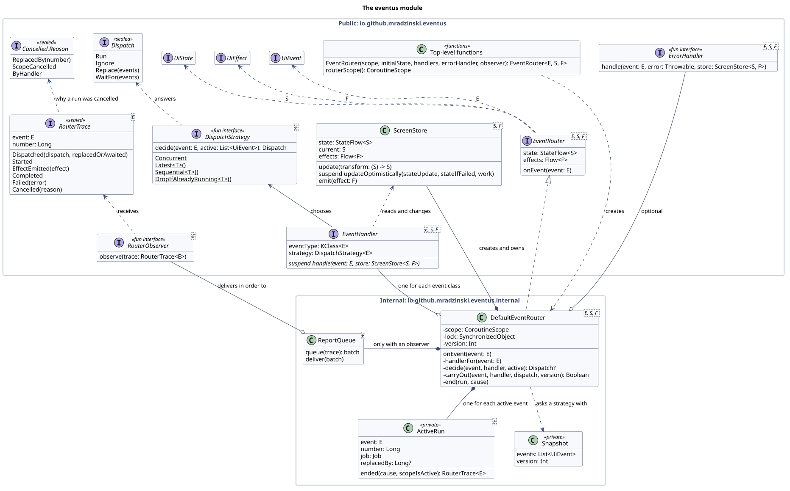

# Class diagram

Every type of the `eventus` module and how the types relate: the public ones your app uses, and the
internal ones behind them. The optional artifacts are not shown.



The public types, in the upper box:

- **`EventRouter`** is what a view model implements, by delegation. The `EventRouter(...)` function
  creates the router behind it.
- **`EventHandler`** reads and changes the store, and chooses a `DispatchStrategy`. A strategy
  answers with a `Dispatch`.
- **`ErrorHandler`** and **`RouterObserver`** are optional. An observer receives a `RouterTrace`
  for each thing the router does with an event.
- **`E`, `S` and `F`** are the screen's event, state and effect types. They extend `UiEvent`,
  `UiState` and `UiEffect`.

The internal types, in the lower box. Your app never names them:

- **`DefaultEventRouter`** is the router. It creates and owns one `ScreenStore`, and holds one
  `EventHandler` for each event class and the optional `ErrorHandler`.
- **`ActiveRun`** is one event that is running or waiting. The router shows a strategy the active
  events as a `Snapshot`.
- **`ReportQueue`** exists only when the router has an observer. It delivers the reports in order.

For what each public type does, see [key concepts](key-concepts.md).

The diagram is written in [PlantUML](https://plantuml.com), in
[`class-diagram.puml`](class-diagram.puml). After a change to that file, draw the picture again:

```bash
plantuml -tsvg docs/class-diagram.puml
```

---

[Back to the README](../README.md#documentation)
