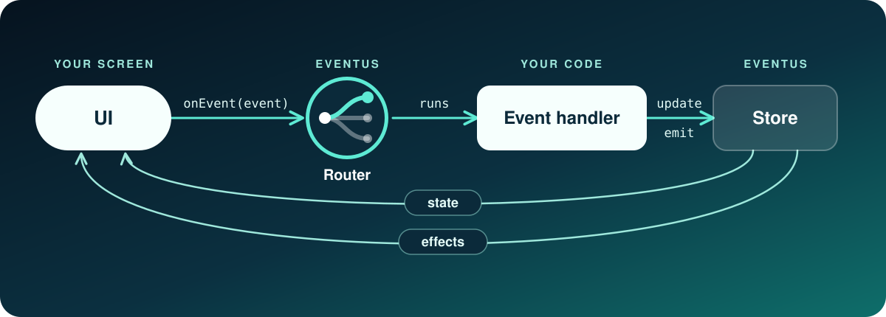

# Key concepts

Eventus is built from a small number of pieces that work together in one loop. This page shows the
loop first and then explains each piece. Read it before the other pages, which assume you know these
terms.

## Contents

- [The loop](#the-loop)
- [The pieces](#the-pieces)
  - [Event](#event)
  - [Event handler](#event-handler)
  - [Store](#store)
  - [State](#state)
  - [Effect](#effect)
  - [Router](#router)
  - [Error handler](#error-handler)
  - [Dispatch strategy](#dispatch-strategy)
  - [Scope](#scope)
  - [At a glance](#at-a-glance)
- [What an event handler produces](#what-an-event-handler-produces)
- [Several view models in one feature](#several-view-models-in-one-feature)
- [Lifecycle](#lifecycle)
- [The rules](#the-rules)
  - [Every event has exactly one event handler](#every-event-has-exactly-one-event-handler)
  - [Declare a screen's events as one sealed type](#declare-a-screens-events-as-one-sealed-type)
  - [A view model routes a sealed type that holds exactly the events it handles](#a-view-model-routes-a-sealed-type-that-holds-exactly-the-events-it-handles)
  - [Keep the state immutable](#keep-the-state-immutable)
  - [An event handler holds no state of the screen](#an-event-handler-holds-no-state-of-the-screen)
  - [The UI never gets the store](#the-ui-never-gets-the-store)
  - [Eventus knows nothing about a UI](#eventus-knows-nothing-about-a-ui)
- [The words these docs use](#the-words-these-docs-use)
- [Where to go next](#where-to-go-next)

## The loop



Take a counter with an Add button:

1. The user taps Add. The UI sends an event: `onEvent(CounterEvent.OnIncrementClick)`.
2. The router finds the one event handler registered for that event's class and runs it.
3. The event handler does its job and writes the result to the store:
   `store.update { it.copy(count = it.count + 1) }`.
4. The store publishes the new state, and the UI draws it.
5. If the event handler also has something for the UI to do once, such as showing a message, it emits
   an effect, and the UI performs it.

Every screen works like this, whatever it does. An event goes in, and state and effects come out.

## The pieces

### Event

Something that happened and must be handled: a tap, a text change, something to report to analytics.
An event is a class or object of your own that implements `UiEvent`. You declare the events of one
screen as one sealed type:

```kotlin
sealed interface CounterEvent : UiEvent {

    data object OnIncrementClick : CounterEvent
    data object OnSaveClick : CounterEvent
}
```

### Event handler

The logic for one event. Each event has exactly one event handler, and each event handler is a class
of its own, with a test of its own. An event handler takes what it depends on in its constructor,
such as a repository, and receives the event and the store with each call:

```kotlin
class OnSaveClickHandler(
    private val counters: CounterRepository,
) : EventHandler<CounterEvent.OnSaveClick, CounterUiState, CounterEffect> {

    override val eventType = CounterEvent.OnSaveClick::class

    override suspend fun handle(event: CounterEvent.OnSaveClick, store: ScreenStore<CounterUiState, CounterEffect>) {
        counters.save(store.current.count)
        store.emit(CounterEffect.Saved)
    }
}
```

### Store

Everything an event handler may do to its screen, in one object: a `ScreenStore`. The router creates
the store and hands it to every event handler. Through the store, an event handler does three things:

- **Changes the state.** It reads the state with `current` and changes it with `update` or
  [`updateOptimistically`](updating-the-state-optimistically.md).
- **Emits an effect**, with [`emit`](emitting-an-effect.md).
- **Dispatches another event** of the same screen, with
  [`dispatch`](dispatching-an-event-from-a-handler.md).

The store holds the state and the effects. A dispatched event goes to the router that handed out the
store. The event handler receives the store and does not hold it, so an event handler keeps nothing
between two events.

### State

Everything the UI needs to draw the screen, as one immutable value that implements `UiState`. The UI
reads it from the router as a `StateFlow`.

```kotlin
data class CounterUiState(val count: Int = 0) : UiState
```

### Effect

Something only the UI can do, once: show a message, navigate, vibrate. An effect implements
`UiEffect`. The store delivers each effect once, to one collector, and keeps an effect until something
collects it. See [emitting an effect](emitting-an-effect.md).

```kotlin
sealed interface CounterEffect : UiEffect {

    data object Saved : CounterEffect
}
```

### Router

What the UI talks to. An `EventRouter` has three members: `state`, `effects` and `onEvent`. You create
one router for each screen with the `EventRouter(...)` function, and your view model hands it to the
UI by delegation, so the view model extends nothing from Eventus.

### Error handler

What the screen does when an event handler fails. Event handlers do not catch their own failures;
they throw, and the router passes every failure to the screen's one `ErrorHandler`, with the event
and the store. See [handling failures](handling-failures.md).

### Dispatch strategy

What the router does with an event while other events are still running or waiting. Four are
ready-made: run it at once, let it replace the one before, run it in order, or ignore it. Each of them
also works across several events or for each item of a list, and you can write your own. Each event
handler chooses its own. See [choosing a dispatch strategy](choosing-a-dispatch-strategy.md).

### Scope

The coroutine scope the router runs event handlers in. The router lives exactly as long as that
scope. In a view model, `routerScope()` creates a scope that the view model and the router share. See
[choosing the coroutine scope](choosing-the-coroutine-scope.md).

### At a glance

| Type | What it is |
|---|---|
| `UiState` | The state of one screen: everything the UI needs to draw it, as one immutable value. |
| `UiEvent` | Something that happened and must be handled: a tap, a text change, something to report to analytics. |
| `UiEffect` | Something the UI must do once and then forget: show a message, navigate. |
| `EventHandler<E, S, F>` | The logic for one event type `E` of a screen whose state is `S` and whose effects are `F`. |
| `ErrorHandler<E, S, F>` | What the screen does when one of its event handlers fails. One per screen. |
| `ScreenStore<S, F>` | The state and effects of one screen. The router creates it and hands it to every event handler. |
| `EventRouter<E, S, F>` | What the UI sees: `state`, `effects` and `onEvent`. Created by the `EventRouter(...)` function. |
| `DispatchStrategy<E>` | What the router does with an event `E` while other events are running or waiting. |
| `Dispatch` | The answer of a strategy: run the event, ignore it, replace other events, or wait for them. |
| `routerScope()` | Creates the coroutine scope a view model and its router share. |
| `RouterObserver<E>` | Optional. Is told what the router does with each event, in order. See [logging events](logging-events.md). |
| `RouterTrace<E>` | One report to a `RouterObserver`: the event, its number and what happened to it or which effect it emitted. |

If your app already has types called `UiState`, `UiEvent` or `UiEffect`, import these with an alias
(`import io.github.mradzinski.eventus.UiState as EventusUiState`) or replace yours with them.

## What an event handler produces

An event handler can produce three things, in any combination, or none of them:

| It is… | When | Example |
|---|---|---|
| **State** | The screen should still show it if the screen were drawn again from scratch. | The count, a loading indicator, a warning under a field. |
| **An effect** | Only the UI can do it, once. | A "Saved" message, opening another screen. |
| **Work** | It needs no UI at all. | Saving to a repository, reporting to analytics. |

Work is done by the event handler itself, through what it depends on. An event handler that only does
work, such as one that reports an event to analytics, changes no state and emits no effect. See
[choosing between an effect and state](choosing-between-an-effect-and-state.md).

## Several view models in one feature

A feature often has more than one view model. Two screens of a feature each have one. And a part of
a screen can have its own: a `Feature()` composable with a view model, which shows a `List()` and an
`Editor()` composable that each have a view model too. A view model does not have to be a screen.

The rule is the same in every such case:

> **Each view model routes a sealed type that holds exactly the events it handles.**

The feature can still have one event type.

> [!TIP]
> **Do:** give each view model a sealed type inside the feature's event type, including the view
> model that sits above the others.
>
> ```kotlin
> sealed interface TasksEvent : UiEvent {
>
>     sealed interface List : TasksEvent {
>
>         data object OnRefresh : List
>     }
>
>     sealed interface Editor : TasksEvent {
>
>         data object OnSaveClick : Editor
>     }
>
>     sealed interface Feature : TasksEvent {
>
>         data object OnBackButtonClick : Feature
>     }
> }
>
> class ListViewModel(/* … */) : EventRouter<TasksEvent.List, ListUiState, ListEffect> by /* … */
>
> class EditorViewModel(/* … */) : EventRouter<TasksEvent.Editor, EditorUiState, EditorEffect> by /* … */
>
> class FeatureViewModel(/* … */) : EventRouter<TasksEvent.Feature, FeatureUiState, FeatureEffect> by /* … */
> ```

> [!CAUTION]
> **Don't:** put an event directly under `TasksEvent` and have `FeatureViewModel` route
> `TasksEvent`. That view model accepts the events of the list and of the editor too.
>
> ```kotlin
> sealed interface TasksEvent : UiEvent {
>
>     sealed interface List : TasksEvent { /* … */ }
>
>     sealed interface Editor : TasksEvent { /* … */ }
>
>     data object OnBackButtonClick : TasksEvent
> }
>
> class FeatureViewModel(/* … */) : EventRouter<TasksEvent, FeatureUiState, FeatureEffect> by /* … */
> ```

A router accepts every event of its type. `TasksEvent.Editor.OnSaveClick` is a `TasksEvent`, so that
`FeatureViewModel` would accept it, find no event handler for it, and throw.

Two things enforce the rule:

- **The compiler.** `FeatureViewModel.onEvent` takes a `TasksEvent.Feature`, so sending it
  `TasksEvent.Editor.OnSaveClick` does not compile.
- **The [build-time check](checking-and-wiring-event-handlers-at-build-time.md).** A view model that
  routes a wider type than it can handle fails the build:

```text
e: [ksp] FeatureViewModel.kt:9: com.example.FeatureViewModel routes every com.example.TasksEvent, but it
can never handle com.example.TasksEvent.Editor.OnSaveClick, com.example.TasksEvent.List.OnRefresh: the
handlers of those events are written for another state or other effects. Give the events that
FeatureViewModel handles a sealed type of their own inside TasksEvent, and route that type.
```

An event is not passed from one router to another. The UI sends each event to the view model that
handles it: the back button calls `FeatureViewModel.onEvent`, and the refresh button calls
`ListViewModel.onEvent`. See [structuring the events of a
feature](structuring-the-events-of-a-feature.md) for the event handlers and their interfaces.

## Lifecycle

- **The router lives as long as its scope.** In a view model, that is until the view model is cleared.
  The state lives with the router.
- **A view model outlives the screen that shows it.** On Android, rotating the device destroys the
  screen and creates it again, and the view model is kept. So the router is untouched: the state, the
  events that are running and the effects that are waiting are all still there for the new screen.
  On iOS a rotation recreates nothing.
- **Sending the app to the background does not stop the router.** Events that are running go on for
  as long as the system lets the app run, the state keeps changing, and an effect waits until the UI
  collects again.
- **The router ends when the view model is cleared or the app's process dies.** A view model is
  cleared when the user leaves its screen for good. A process dies when the system stops the app to
  reclaim memory, or when the app crashes. Eventus brings nothing back after either; see
  [what Eventus does not do](what-eventus-does-not-do.md).
- **An event handler holds nothing about the screen.** Your dependency-injection container can create
  a fresh one for each view model.
- **A run lasts until the event handler returns.** An event handler that does not return by itself,
  such as one that collects a flow, runs until the scope is cancelled. See
  [keeping work running](keeping-work-running.md).
- **An effect waits until something collects it.** An effect emitted while nothing collects is not
  lost.

## The rules

### Every event has exactly one event handler

An event with no event handler throws when it is sent, and two event handlers for one event stop the
router from being created. The optional
[build-time check](checking-and-wiring-event-handlers-at-build-time.md) finds both when you build.

```kotlin
sealed interface CounterEvent : UiEvent {

    data object OnIncrementClick : CounterEvent

    data object OnSaveClick : CounterEvent
}

// Two events, so two event handlers, and the router gets both.
val handlers = listOf(OnIncrementClickHandler(), OnSaveClickHandler(counters))
```

Leave `OnSaveClickHandler` out of that list, and the first tap on Save throws:

```text
No handler registered for OnSaveClick
```

Put `OnIncrementClickHandler` in the list twice, and creating the router throws:

```text
Multiple handlers registered for OnIncrementClick: [OnIncrementClickHandler, OnIncrementClickHandler]
```

### Declare a screen's events as one sealed type

The router matches each event by its exact class, so an event handler registered for a parent type
does not receive the events of its subtypes.

> [!TIP]
> **Do:** write one event handler for each event of the sealed type.
>
> ```kotlin
> class OnIncrementClickHandler : CounterHandler<OnIncrementClick> {
>
>     override val eventType = OnIncrementClick::class
>
>     override suspend fun handle(event: OnIncrementClick, store: CounterStore) { /* … */ }
> }
> ```

> [!CAUTION]
> **Don't:** register an event handler for the parent type. No event has the class `CounterEvent`
> itself, so the router never calls it.
>
> ```kotlin
> class AnyCounterEventHandler : CounterHandler<CounterEvent> {
>
>     override val eventType = CounterEvent::class
>
>     override suspend fun handle(event: CounterEvent, store: CounterStore) { /* … */ }
> }
> ```

### A view model routes a sealed type that holds exactly the events it handles

A router accepts every event of its type, so that type must not be wider than what the view model
can handle.

```kotlin
sealed interface TasksEvent : UiEvent {

    sealed interface List : TasksEvent { /* … */ }

    sealed interface Editor : TasksEvent { /* … */ }
}
```

> [!TIP]
> **Do:** route the list's events and nothing else.
>
> ```kotlin
> class ListViewModel(/* … */) : EventRouter<TasksEvent.List, ListUiState, ListEffect> by /* … */
> ```

> [!CAUTION]
> **Don't:** route the whole feature's type. This view model would also accept the editor's events,
> which it cannot handle.
>
> ```kotlin
> class ListViewModel(/* … */) : EventRouter<TasksEvent, ListUiState, ListEffect> by /* … */
> ```

See [several view models in one feature](#several-view-models-in-one-feature).

### Keep the state immutable

`store.update { it.copy(...) }` builds a new value. A value that was changed in place is equal to the
old one, so the store never emits it and the UI never sees the change.

> [!TIP]
> **Do:** keep a read-only list, and build a new state with a new list.
>
> ```kotlin
> data class TaskListUiState(val tasks: List<Task> = emptyList()) : UiState
>
> store.update { it.copy(tasks = it.tasks + task) }
> ```

> [!CAUTION]
> **Don't:** keep a list that can be changed in place. The state after the change is the same object
> as before, so nothing is emitted.
>
> ```kotlin
> data class TaskListUiState(val tasks: MutableList<Task> = mutableListOf()) : UiState
>
> store.update { state ->
>     state.tasks.add(task)
>
>     state
> }
> ```

### An event handler holds no state of the screen

What must outlast one event goes in the store. A value kept in an event handler is invisible to the
UI and to every other event handler.

> [!TIP]
> **Do:** keep the count in the state.
>
> ```kotlin
> class OnIncrementClickHandler : CounterHandler<OnIncrementClick> {
>
>     override val eventType = OnIncrementClick::class
>
>     override suspend fun handle(event: OnIncrementClick, store: CounterStore) {
>         store.update { it.copy(count = it.count + 1) }
>     }
> }
> ```

> [!CAUTION]
> **Don't:** keep the count in the event handler.
>
> ```kotlin
> class OnIncrementClickHandler : CounterHandler<OnIncrementClick> {
>
>     private var count = 0
>
>     override val eventType = OnIncrementClick::class
>
>     override suspend fun handle(event: OnIncrementClick, store: CounterStore) {
>         count++
>     }
> }
> ```

An event handler does hold its dependencies, such as a repository. Those are not state of the screen.

### The UI never gets the store

The UI reads `state` and `effects` and calls `onEvent`. Only event handlers, and the error handler,
write to the store.

```kotlin
// Everything a screen needs: the state to draw, and a way to send events.
@Composable
fun CounterScreen(state: CounterUiState, onEvent: (CounterEvent) -> Unit) {
    Button(
        onClick = { onEvent(OnIncrementClick) },
    ) {
        Text("Count: ${state.count}")
    }
}
```

### Eventus knows nothing about a UI

Nothing in the router starts or stops because a screen is visible or hidden. Work is tied to the
router's scope, which for a view model ends when the view model is cleared.

```kotlin
class ChatViewModel(/* … */) : ViewModel(scope), EventRouter<ChatEvent, ChatUiState, ChatEffect> by /* … */ {

    init {
        // Runs for as long as the view model lives, whether the screen is visible or not.
        onEvent(ChatEvent.OnScreenOpened)
    }
}
```

To stop costly work while the screen is hidden, the UI sends an event of your own; see
[keeping work running](keeping-work-running.md).

## The words these docs use

- **Screen:** whatever one router serves. That is usually a screen of your app, but it can be anything
  with events and state, such as an app bar shared by several screens.
- **Run:** one execution of an event handler, for one event.
- **Store:** the `ScreenStore` of a screen.
- **Collector:** the code that receives the effects, usually in the UI.
- **Handler:** short for event handler, once a page has said which kind it means. An error handler is
  always called by its full name.

## Where to go next

- To choose how an event handler behaves under repeated events:
  [choosing a dispatch strategy](choosing-a-dispatch-strategy.md).
- To give event handlers to a view model: [dependency injection](dependency-injection.md).
- To decide what happens when an event handler fails: [handling failures](handling-failures.md).
- To test what you wrote: [testing](testing.md).

---

[Back to the README](../README.md#documentation)
